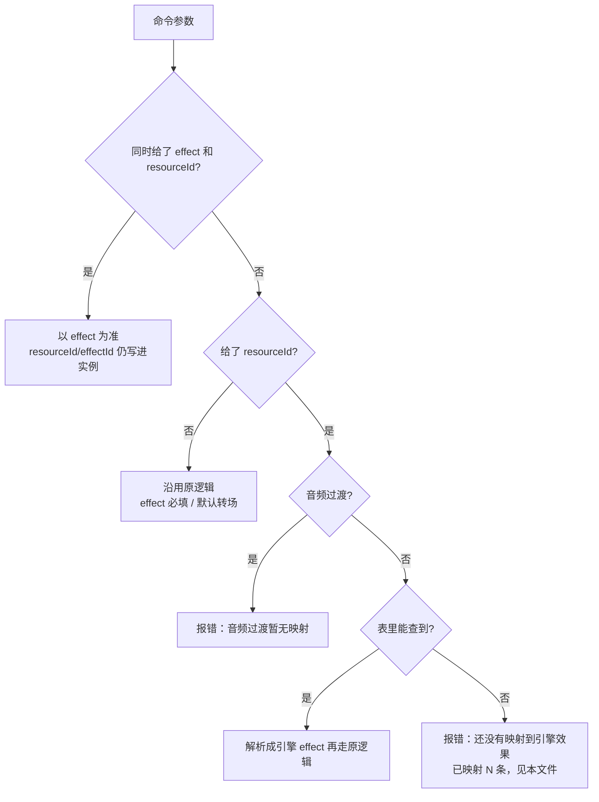

# 剪映「按编号选型」映射表（手工验证子集）

> **Last reviewed:** 2026-10-22 · **Last updated:** 2026-10-22 · **Change:** new file · **Target:** `crates/engine/src/resource_map.rs`

剪映草稿里的转场资源带一个 19 位编号（`resourceId`）。引擎能渲染的是
[`crates/project/src/vtransition.rs`](../crates/project/src/vtransition.rs) 里的转场定义
（`cross_dissolve`、`dip_to_white` …）。这张表把**语义已逐条人工核对**的编号翻译成引擎 effect id，
让 `effects.apply` 和 `sequence.applyVideoTransition` 在只给编号时真的能执行。

**这不是完整映射，也不允许被当成完整映射使用。** 表中没有的编号一律报错（错误里给出编号、
已映射条数和本文件路径），绝不按名称猜测、绝不回退到默认转场——猜错会悄悄改变用户片子的观感。

## 已映射的 5 条

| 剪映编号 (`resourceId`) | 剪映名称 | 引擎 effect id | 引擎面板位置 |
|---|---|---|---|
| `6724845717472416269` | 叠化 | `cross_dissolve` | Video Transitions / Dissolve |
| `6724845376098013708` | 闪白 | `dip_to_white` | Video Transitions / Dissolve |
| `6724239388189921806` | 闪黑 | `dip_to_black` | Video Transitions / Dissolve |
| `6724226861666144779` | 推近 | `push` | Video Transitions / Slide |
| `6747979085894390279` | 翻页 | `page_turn` | Obsolete / Video Transitions |

表在代码里的唯一事实源是
[`RESOURCE_TRANSITIONS`](../crates/engine/src/resource_map.rs)；`mapped_count()` 返回它的长度（当前 5）。

## 命令行为



- `sequence.applyVideoTransition`：只给 `resourceId` 时按表解析成引擎转场 id，再按 `clip`/`edge`/
  `frames`/`params` 应用；`sequence.inspect` 里该转场的 `effect` 是解析后的引擎 id，`resourceId` 回显。
- `sequence.applyAudioTransition`：音频过渡**不在本次映射内**，只给 `resourceId` 报「音频过渡暂无映射」；
  想用音频过渡请显式给 `effect`（如 `constant_power`）。
- `effects.apply`：缺 `effect` 但给了 `resourceId` 时按表解析；解析到的若是转场，走与转场命令相同的
  应用路径。解析不到即可读错误。
- 两者同时给：以 `effect` 为准，编号只作为实例元数据（现有行为，不变）。
- 参数校验仍然先行：裸数字、空串、纯空白串会被拒绝，且不会留下任何编辑。

## 为什么只做这 5 条子集

1. **语义必须可核对。** 编号对应的是剪映自己的素材，名称相近不等于画面相同（「推近」和引擎的
   `push` 是否同一运动方向、`page_turn` 的翻页轴是否一致，都要逐条看素材/成片确认）。批量猜表会
   制造「能跑但观感错了」的静默错误，比报错更难发现。
2. **宁缺毋滥。** 未映射时错误信息已经给出编号、已映射条数和文档位置，用户/代理能据此决定是显式
   指定引擎转场，还是先把编号补进表。报错是可恢复的；猜错不是。
3. **表是接口契约。** 每一行都会被测试证明「能在 `find_transition` 里查到」，加行即有回归保护；
   一次加几十行没有核对过的映射，等于把测试变成摆设。
4. **音频过渡的语义差异更大**（等功率、指数淡化、淡入淡出方向），本次不碰。

## 如何扩充（一次一行）

1. **人工核对语义**：拿到该编号在剪映里的实际素材/成片，与
   [`crates/project/src/vtransition.rs`](../crates/project/src/vtransition.rs) 里候选引擎转场的参数和
   画面表现逐项比对（方向、轴、颜色、时长行为）。核对不了就不加。
2. **加一行**到 [`RESOURCE_TRANSITIONS`](../crates/engine/src/resource_map.rs)：
   `("19位编号", "剪映名称", "引擎 effect id")`。编号必须是 19 位数字字符串（保留前导零），
   引擎 id 必须是 `find_transition` 能查到的转场 id，一个编号只能有一行。
3. **补测试**：`every_mapped_row_names_a_real_video_transition` 会自动覆盖新行（可查、id 一致、
   不重复）；如果新编号值得单独验证执行路径，再在
   [`crates/engine/src/resource_map_tests.rs`](../crates/engine/src/resource_map_tests.rs) 补一条
   「只给编号也能应用」的用例。
4. **跑门禁**：

   ```powershell
   $env:CARGO_INCREMENTAL = "0"
   cargo test -p filmcraft-engine --lib resource
   cargo fmt -p filmcraft-engine --check
   cargo clippy -p filmcraft-engine --lib --no-deps -- -D warnings
   ```

5. **更新本文件的表**（编号、名称、引擎 id、面板位置），并把 `mapped_count()` 的期望值同步到
   任何硬编码了条数的断言/文案里。
