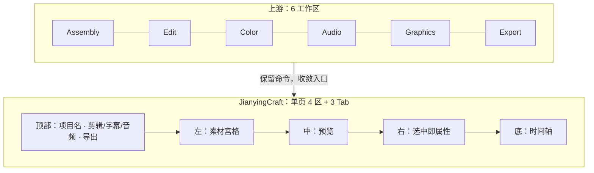
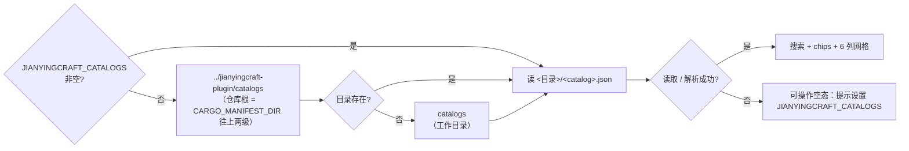

# 剪映式信息架构映射

> 依据：`openspec/changes/derive-from-filmcraft/`（唯一规格事实源）任务 3「剪映式布局取向」。
> 约束：只动 `crates/ui-egui`；命令 id 一律复用上游 165 条命令面；不改 engine/project/render 公共 API。

## 1. 为什么不是"换个皮肤"

上游是 Premiere 的复刻：6 个工作区、Source/Program 双监视器、面板可任意浮动拆分。
剪映/CapCut 的模型是**单页流水线**：素材在左、预览在中、属性在右、时间轴在底，
高频动作在同一屏完成。差别在信息架构，不在引擎。

## 2. 布局模型

| 断点 | 判定 | 行为 |
|---|---|---|
| Compact | 宽度 < 768 | 单列：预览 → 时间轴 → 底部抽屉（素材/属性） || Medium | 768–1024 | 预览上 / 时间轴下；素材与属性为可收起侧栏（240 px） |
| Wide | > 1024 | 四区常驻；时间轴高度 = 视口 38%，可拖拽 |

**实现状态**：Compact 与 Medium 均已走单页壳（`dock_ui::shell_area`）。两档共用一条顶栏：
`☰` + **3 个主 Tab + 「更多」溢出菜单**（13 个入口收进顶栏）+ 右侧 `Properties`；全局 Premiere 菜单条在这两档隐藏，
菜单收进 `☰` 的两级列表（`jy.menu` → 根 → 命令）。点 Tab 决定抽屉画哪个面板
（`UiState.jy_shell_panel`），未实现的 4 个（智能包装/模板/数字人/插件）灰显不可点。
Compact 抽屉从底部展开、只压缩预览；Medium 抽屉改为右侧 240 px 侧栏，时间轴下限 240 px。两档的时间轴上方都有 7 个按钮的工具条（Medium 36 px、Compact 40 px）。
两档都不改时间轴矩形、不改 `sequence.inspect`。

Wide 档的内置工作区 **`Jianying`** 已按剪映专业版补齐四件外壳（全部有测试）：

| 外壳 | 位置 | 状态 |
|---|---|---|
| 13 个一级 Tab（顶栏 3 个主 Tab + 「更多」里 10 个：素材/音频/文本/贴纸/特效/转场/字幕/智能包装/滤镜/调节/模板/数字人/插件） | 顶部 42 px | 9 个可导航；「音频」按类型过滤素材、其余只做面板导航；智能包装/模板/数字人/插件灰显 |
| 左栏竖向 rail（导入/素材/子草稿/我的/AI/云素材/官方/即梦） | 左侧 56 px | 导入发 `file.import`、素材切 Project；其余 6 个灰显 |
| 右栏草稿参数（未选中片段时） | Properties 面板 | 名称/分辨率/帧率/时长/轨道/素材数 |
| 时间轴工具条（撤销/重做/分割/删除/播放/定格/倒放） | Timeline 顶部 38 px | 只转发既有命令；按钮跟随 `enabled` + 选区状态置灰；播放中显示"暂停" |
| 空工程提示（"把素材拖到这里，开始你的大作吧"） | Project 面板居中 | 自动化 id `project.emptyHint`；有素材后消失 |
| 右上角「导出」 | Wide Tab 条右侧 / 移动端顶栏最右 | 调 `file.exportMedia`（无 path）进入 Export 模式 |

首屏默认：全新安装（数据目录里没有 `workspaces.json`）进 `Jianying`；老用户保留上次选择
（`apps/filmcraft/src/main.rs::first_run_workspace`）。Compact/Medium 的 ☰ 菜单已改成两级
（根菜单 → 命令），并保留过滤框。

尚未完成：抽屉内面板滚动条常显、Tab 的素材库内容（音乐/贴纸/模板库属于云生态，不做）。

**实现要求**：断点判断只允许出现在 `crates/ui-egui/src/layout.rs` 的 `LayoutClass::from_width`
一处（已落地，6 条单测覆盖边界与恶意宽度），其余面板只读结果。禁止在各面板里散落
`available_width < 768` —— 否则三档行为必然漂移。当前档位可通过控制通道读到：
`ui.inspect` → `layoutClass`（`compact` / `medium` / `wide`）。

## 3. 面板 → 区域映射

| 上游文件 | 归属 | 改造动作 |
|---|---|---|
| `panels/media_browser.rs` | 左·素材 | 列表改宫格；加类型筛选、搜索、拖入导入 |
| `panels/import_mode.rs` | 左·素材（导入态） | 去掉字标绘制，改为拖放区 |
| `panels/monitor.rs` + `monitor_view.rs` | 中·预览 | 去掉 Source/Program 双监视器，保留源预览浮层 |
| `panels/effect_controls*.rs` | 右·属性 | 合并为分组折叠：基础/变速/动画/音频/调色 |
| `panels/lumetri.rs` | 右·属性（调色） | 收进"调色"分组，控件不删减 |
| `panels/effects.rs` | 右·属性（效果库） | 改可搜索列表，不占独立面板 |
| `panels/timeline*.rs`（6 个文件） | 底·时间轴 | 轨道头 ≤96 px；主轨磁吸；字幕轨置顶 |
| `panels/text.rs` + `tts.rs` | Tab·字幕 | 文案 + 配音 + 字幕样式三块 |
| `panels/mixer.rs` + `meters.rs` + `audio_fx_editor.rs` | Tab·音频 | 混音器与响度表同屏 |
| `panels/export_mode.rs` | 顶部·导出 | 改右侧抽屉，预设置于首屏 |
| `panels/multicam.rs` / `scopes.rs` / `reference.rs` | 高级模式 | 默认隐藏，命令可达 |

## 4. 交互契约（不得违背）

1. **选中即属性**：右侧属性区的唯一输入是 `sequence.inspect` 的 selection；切换 Tab 不清选区。
2. **播放不中断**：Tab 切换、抽屉开合、属性折叠都不得触发 `playback.stop`。
3. **主轨磁吸是视图约定**：主轨 = 第一条 V 轨，不是新数据字段；`timeline.place` 的帧栅格语义不变。
4. **命令优先**：任何控件必须有对应命令 id，不允许"只能点、不能命令"。
5. **automation id**：新增控件注册 `jy.<region>.<control>`，region ∈ `media|preview|inspector|timeline|topbar|drawer`。

## 5. 三档验收

共 5 条（IA-1..IA-5）。每条都由 `crates/ui-egui/tests/` 下的集成测试锁定：`egui_kittest` Harness
驱动真实窗口，经控制通道断言可观察的矩形、`ui.inspect` 状态与 `sequence.inspect` JSON，
截图只作补充，不作为唯一证据。

| 编号 | 验收 | 证据（测试文件 → 测试名） |
|---|---|---|
| IA-1 | 390×884 无横向溢出；导入/分割/字幕/导出 4 个动作 **0 次页面切换**——定义为「留在同一个单窗口工作区：不新开 OS 窗口、不换工作区、不改 dock 树」；「导出」按剪映参考行为进入**窗口内**的 Export 屏幕（`ui.inspect.ui.mode` 由 `Edit` 变 `Export`，属于该屏幕内的模式切换，不算页面切换） | `tests/ia_acceptance_ui.rs` → `ia1_compact_has_no_page_overflow`、`ia1_compact_actions_keep_the_window_and_the_dock`、`ia1_wide_rail_import_does_not_leave_the_workspace`、`ia1_export_enters_export_mode_without_leaving_the_workspace`；`tests/layout_ui.rs` → `layout_class_matches_the_three_target_viewports`、`compact_top_bar_has_the_export_button`；`tests/project_media_grid_ui.rs` → `a_file_dropped_on_the_window_is_imported`、`search_filters_the_media_grid`、`type_chips_filter_the_media_grid` |
| IA-2 | 768×1024 侧栏可收起且不遮挡预览 | `tests/ia_acceptance_ui.rs` → `ia2_tablet_768_inspector_sits_right_of_the_preview`、`ia2_medium_inspector_sits_right_of_the_preview`；`tests/layout_ui.rs` → `medium_layout_uses_a_right_sidebar`；`tests/properties_groups_ui.rs` → `properties_panel_has_the_five_jianying_groups_and_they_collapse` |
| IA-3 | 1280×1024 四区常驻，时间轴高度可拖拽 | `tests/ia_acceptance_ui.rs` → `ia3_wide_keeps_four_regions_and_a_draggable_timeline`；`tests/layout_ui.rs` → `wide_default_workspace_is_the_four_regions`；`tests/timeline_layout_ui.rs` → `jianying_track_headers_are_at_most_96_px_wide`、`caption_track_header_matches_the_video_track_header_width`、`caption_tracks_sit_above_the_video_tracks`、`dragging_a_clip_snaps_to_the_neighbour_edge`、`dragging_a_clip_snaps_to_the_primary_track_edge`、`dragging_a_clip_near_the_primary_track_lands_on_it` |
| IA-4 | 重排前后 `sequence.inspect` 的 clips/effects 完全一致 | `tests/ia_acceptance_ui.rs` → `ia4_inspector_round_trip_leaves_the_sequence_untouched`（按 `video` / `audio` 轨道整段做 JSON 相等比较，同时覆盖片段与 `effects[]`） |
| IA-5 | Tab 切换期间播放不中断、选区不丢 | `tests/ia_acceptance_ui.rs` → `ia5_playback_and_selection_survive_tab_switches`；`tests/tab_switch_ui.rs` → `wide_tabstrip_switches_keep_playback_and_selection`、`compact_shell_tab_switches_keep_playback_and_selection` |

**复跑（2026-10-20，`--test-threads=1`）**：`cargo test -p filmcraft-ui-egui --test ia_acceptance_ui`
→ **9 passed / 0 failed**；`--test layout_ui` → 29、`--test tab_switch_ui` → 2、
`--test project_media_grid_ui` → 3、`--test timeline_layout_ui` → 6、`--test properties_groups_ui` → 2，
均 0 failed。逐条命令与结果另见 `docs/derivation/11-acceptance-report.md` §11。

> **2026-10-20 澄清 IA-1 的「0 次页面切换」**：原表述没有区分「换页面」与「进入导出屏幕」，
> 而剪映的参考行为是导出进入窗口内的专属屏幕——它不新开 OS 窗口、不换工作区、不改 dock 树，
> 也不发生路由/导航跳转。因此把该条款定义为上述单窗口约束；`mode` 的 `Edit → Export`
> 是同一窗口内的屏幕切换，不算页面切换。
>
> 做出这一取舍的理由：剪映产品对照（§7）里导出是独立屏幕而非抽屉/浮层，而本项目已按此实现并
> 有测试锁定（`crates/ui-egui/tests/layout_ui.rs::compact_top_bar_has_the_export_button`）。
> IA-1 的导出断言是
> `crates/ui-egui/tests/ia_acceptance_ui.rs::ia1_export_enters_export_mode_without_leaving_the_workspace`
> （工作区、dock、窗口尺寸不变，`mode == "Export"`）；把「0 次页面切换」读成「导出后 `mode` 不变」
> 的旧断言已删除，因为它编码的是产品已拒绝的读法。

## 6. 不做

- 不新增"主轨/字幕轨"的数据概念（沿用上游 caption track 与第一条 V 轨）。
- 不为移动端单独写一套命令（命令面唯一）。
- 不删除上游命令与快捷键，只是不再占据默认入口。

## 7. 剪映实测界面清单（截图基准 2026-10-18）

用户在 1280×1024 窗口下截取的剪映（JianYingPro）空工程界面，作为"非核心剪辑能力"的对照基线。
界面分六区：顶部 Tab 条、左侧素材栏、中部预览、右侧草稿参数、底部时间轴、时间轴工具条。

### 7.1 顶部一级 Tab（3 个主 Tab + 「更多」10 个，共 13 个）

| Tab | 作用 | FilmCraft 落点 | 状态 |
|---|---|---|---|
| 素材 | 媒体库与导入 | `panels/media_browser.rs` + `media_import` | 复用 |
| 音频 | 音乐/音效库、配音 | `panels/mixer.rs`、`meters.rs`、`tts.rs` | 复用（无在线曲库） |
| 文本 | 字幕、花字、文字模板 | `panels/text.rs` | 复用 |
| 贴纸 | 贴纸/动图素材 | `panels/graphics.rs` + `graphics_templates.rs` | 部分复用（无在线素材） |
| 特效 | 画面特效 | `panels/effects.rs` | 复用 |
| 转场 | 转场库 | `crates/edit/src/transitions.rs` | 复用 |
| 字幕 | 识别字幕/导入字幕 | `crates/captions` + `panels/timeline_captions.rs` | 复用，需重排入口 |
| 智能包装 | 一键字幕+花字+封面+标题组合 | 无 | **新建（P3）** |
| 滤镜 | LUT 滤镜库 | `crates/color/src/lut.rs` + `panels/lumetri.rs` | 复用 |
| 调节 | 曝光/色温/HSL 等参数 | `panels/lumetri.rs` | 复用 |
| 模板 | 成片模板（替换素材即成片） | 无 | **新建（P3，先本地模板）** |
| 数字人 | 云端数字人播报 | 无 | 不做（依赖云服务） |
| 插件 | 第三方扩展市场 | ZCode 插件面板本身 | 不做（不重复造） |

### 7.2 左侧素材栏（二级）

导入 / 素材 / 子草稿 / 我的 / AI 生成 / 云素材 / 官方素材 / 即梦 AI。

| 项 | 落点 | 状态 |
|---|---|---|
| 导入 + 素材 | `import_mode.rs`、`media_browser.rs`、`file.newBin` | 复用 |
| 子草稿 | 上游嵌套序列（nested sequence） | 复用，补入口 |
| 我的 | 工程内 bin 收藏 | 复用 |
| AI 生成 / 云素材 / 官方素材 / 即梦 AI | 无（全部依赖云端账号） | 不做，留扩展位 |

### 7.3 右侧「草稿参数」（未选中任何片段时）

草稿名称、保存位置、导出路径、导入方式（保留在原位置/复制到草稿）、自由层级、素材代理、
代理模式、时间线名称、比例（适应）、分辨率（适应）、草稿帧率（30 fps）、修改按钮。

| 参数 | FilmCraft 落点 | 状态 |
|---|---|---|
| 草稿名称 / 时间线名称 | 工程与序列名 | 复用 |
| 保存位置 / 导出路径 | 文件服务（桌面原子写、Web 下载） | 复用，补只读展示 |
| 导入方式 | `media_import` 的引用/复制策略 | **新增开关** |
| 自由层级 | 同轨重叠（overlap） | **需确认上游策略**，差异点 |
| 素材代理 / 代理模式 | 上游 proxies 作业 | 复用，补 UI |
| 比例 / 分辨率 / 帧率 | 序列设置 | 复用，改为竖屏默认；#84 起 `project.quickShortVideo` 一条命令建出 1080×1920/30，可选旁白与空字幕轨 |

> "新建短视频工程"：早期口径是 `file.newSequence` + 参数两步；#84 之后可以用
> `project.quickShortVideo` 一条命令完成（`File ▸ New`），参数与回滚语义见
> `docs/proposals/remaining-openspec-decisions.md` §1 与 `crates/engine/src/quick_short_video.rs`。

这条正好验证了第 4 节「选中即属性」的设计：**未选中时右栏就是工程/序列参数**。

### 7.4 播放器条

时间帧显示（`00:00:00:00`）、播放/暂停、逐帧、缩放、全屏、比例切换。

落点：`panels/monitor.rs`、`monitor_view.rs`；自动化 id 前缀 `jy.preview.*`。

### 7.5 时间轴工具条

左：撤销、重做、分割、删除、定格、倒放、镜像、旋转、裁剪、速度（`1.0x`）、音量、降噪、变声。
右：吸附、主轨磁吸、联动、自动吸附、时间轴缩放、更多。

| 工具 | FilmCraft 命令 | 状态 |
|---|---|---|
| 撤销/重做 | `edit.undo` / `edit.redo` | 复用 |
| 分割 | `timeline.razor` | 复用 |
| 删除/定格/倒放/镜像/旋转/裁剪 | 上游对应命令（以 `command_list` 为准） | 复用，需按剪映顺序重排 |
| 速度 | 变速命令 + `1.0x` 浮层 | 复用，补浮层 |
| 音量/降噪/变声 | 音频命令（降噪/变声可能缺） | 部分新建 |
| 吸附/主轨磁吸/联动 | UI 状态 | 新增（视图层） |

### 7.6 空态

时间轴空态提示"素材拖拽到这里，开始你的大作吧~"，左栏与预览也有对应空态。

落点：新增空态组件；验收要求空态下不出现空白面板（IA-1 补充）。

### 7.7 由此产生的优先级修正

- **P2 必做**：13 Tab 收敛为 3 个主 Tab + "更多"溢出菜单；左栏层级；右栏工程参数；底部工具条
  前 8 个高频工具；空态引导。
- **P3 再做**：智能包装、本地模板、代理模式 UI、子草稿入口。
- **不做**：数字人、云素材、官方/即梦素材、插件市场。

> 结论：剪映"除核心剪辑之外"的体积，大头是**素材生态与云端能力**（不做），
> 其次是**一键包装/模板**（P3 本地化），真正影响首屏可用性的只有
> 左栏层级、右栏工程参数、底部工具条与空态四件事。

## 8. 资源 Tab 的浏览态

对照 13 张真实剪映截图（音频 / 文本 / 贴纸 / 特效 / 转场 / 滤镜 / 字幕 / 模板 / 导入），
资源类 Tab 的首屏不是 Premiere 的效果树，而是**搜索 + 分类 chips + 密集资源网格**。
`crates/ui-egui/src/panels/resource_catalog.rs` 实现这一浏览态，并在 `Jianying` 工作区
接管对应面板（`dock_ui::panel_body` 分派，其它工作区/Tab 保持原逻辑）。

### 8.1 数据：运行时读目录，不打包进二进制

资源目录在插件仓 `jianyingcraft-plugin/catalogs/*.json`（条目字段 `name` / `resource_id` /
`vip`）。程序**运行时**读取，不使用 `include_str!`：目录可以更新，也可以被用户放到任意位置。
查找顺序（先命中先用）：

| 剪映 Tab | 目录文件 | 接管的面板 |
|---|---|---|
| 转场 `transitions` | `transitions.json` | Effects |
| 滤镜 `filters` | `filters.json` | Lumetri Color |
| 特效 `effects` | `video_scene_effects.json` | Effects |
| 贴纸 `sticker` | `video_scene_effects.json`（与场景特效共用目录，网格下方有说明） | Essential Graphics |
| 文本 `text`（宽屏 Tab 行）/ `captions`（Compact 顶栏） | `text_animations_in.json` | Text |
| 字幕 `captions`（宽屏 Tab 行）/ `subtitle`（Compact 顶栏） | `fonts.json` | Text |
| 音频 `audio` | `audio_scene_effects.json` | 不接管：保留素材浏览器（音频 Tab 仍列工程音频素材） |

每一类按（文件长度, mtime）缓存，切 Tab / 重绘不重复解析 500 KB 级 JSON；文件删除后缓存失效，
下一次读取直接进入空态，不会继续画旧列表。

### 8.2 界面（对照截图）

- 顶部 22 px 通栏搜索框，占位「搜索名称/编号」，同时匹配名称与 `resource_id`（忽略大小写）。
- 下一行 chips：`全部` / `免费` / `会员`（按 `vip` 过滤），右侧「N 条」随过滤结果更新。
- 主体固定 **6 列方形卡片**，行距 6 px，可滚动；卡片 = 方形缩略图区 + 名称（11 px，单行省略）
  + 编号后 6 位（9 px 灰字）+ 右上会员角标。
- 缩略图是**按 `resource_id` 哈希生成的渐变占位**（首字居中）。官方缩略图/预览素材不随本仓库
  分发（AGENTS.md §1：素材必须有授权与 sidecar），这里不伪造、不内嵌官方图片；接入真实缩略图
  属于后续任务。

自动化 id：`resource.search`、`resource.chip.<all|free|vip>`、`resource.count`、
`resource.grid`、`resource.card.<resource_id>`、`resource.empty`、`resource.note`。

### 8.3 交互与空态

- 单击卡片：选中（1 px 强调色描边），并把「名称 + resource_id」写进状态栏，例如
  `已选转场「3D空间」· 7049979667406656014；把它写进 action plan 即可`。**不执行任何副作用**；
  双击/回车应用资源留给后续任务。
- 目录不存在、JSON 损坏或没有可用条目：画出可操作的空态，明确提示设置
  `JIANYINGCRAFT_CATALOGS` 指向 `jianyingcraft-plugin/catalogs`（或把 `catalogs/` 放到工作目录），
  不 panic、不阻塞其它面板。
- 过滤结果为空（目录本身正常）：提示换关键词或点「全部」。

回归测试：`crates/ui-egui/tests/resource_catalog_ui.rs`（临时目录 + 2 免费 + 1 会员，覆盖搜索、
chips、卡片数量、点选状态栏、目录消失后的空态）。

### 8.4 剩余缺口

- **真实缩略图/预览**：需要可授权的官方素材或自建缩略图流水线；当前只有哈希渐变占位。
- **分类树/二级分类**：目录 JSON 里没有剪映的分类层级，"热门/收藏/我的"等云端分区也不做。
- **下载与会员校验**：会员角标只用于浏览过滤；没有账号体系、授权或素材下载。
- **应用到时间线**：选中只写状态栏；把资源写进 action plan / 拖到片段上仍是后续任务。

